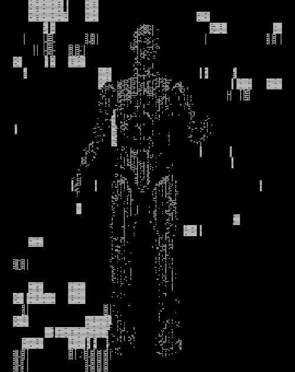

<!-- ==================== ORIGINAL BANNER ==================== -->

  

  

<!-- ==================== MAIN TWO-COLUMN LAYOUT ==================== -->
<table>
<tr>

<!-- ==================== LEFT COLUMN ==================== -->
<td width="65%" valign="top">

## 01 / PERFIL · PROFILE

Desarrollador de software junior con experiencia práctica en aplicaciones web y multiplataforma, soluciones empresariales e integración de servicios.

Junior software developer with hands-on experience in web and cross-platform applications, business solutions, and service integrations.

**Ubicación / Location:** Medellín, Colombia

## 02 / TECH STACK

**BACKEND & LANGUAGES**

  

**FRONTEND & MOBILE**

  

**DATABASES, ORM & INFRASTRUCTURE**

  

  

**AI-POWERED DEVELOPMENT**

  
  
  

**ENGINEERING & PRACTICES**

`Spec-Driven Development` · `Clean Architecture` · `CQRS` · `Microservices` · `Webhooks` · `Git`

## 03 / EXPERIENCE

### INTAP S.A.S. — Software Development

*Apr 2026 – Oct 2026*

- Desarrollo y mantenimiento de funcionalidades frontend y backend.
- Participación en soluciones de omnicanalidad y gestión de procesos empresariales.
- Integración de servicios, mensajería, webhooks y notificaciones.
- Trabajo colaborativo con Git, Bitbucket y herramientas de desarrollo asistido por IA.

### ASTROSTAR — Web & Mobile Application

Proyecto colaborativo para la gestión administrativa de una fundación de fútbol femenino.

`React` `Node.js` `Flutter` `Relational Databases`

## 04 / LEARNING

**Artificial Intelligence · Cloud Computing · Software Architecture**

Formación complementaria en inteligencia artificial, cloud computing, redes y ciberseguridad.

**English:** B1 — actualmente fortaleciendo mis habilidades.

</td>

<!-- ==================== RIGHT COLUMN ==================== -->
<td width="35%" valign="top">

# ANDERSON
# MURILLO

**DESARROLLADOR DE SOFTWARE JUNIOR**

FULL STACK SOFTWARE DEVELOPER

 

📍 **MEDELLÍN, COLOMBIA**

 

  

  

  

<!-- GITHUB STATISTICS -->

  

<!-- MOST USED LANGUAGES -->

  

<!-- ANIMATION: DISPLAYED ONLY ONCE -->

 

◈ SYSTEMS · CODE · INNOVATION ◈

</td>
</tr>
</table>

<!-- ==================== FULL-WIDTH CONTRIBUTION STREAK ==================== -->
## 05 / CONTRIBUTION STREAK

  

<!-- ==================== FOOTER ==================== -->

  

  DESIGN · ENGINEER · BUILD · EVOLVE

